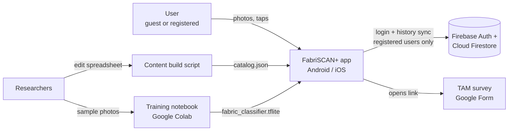
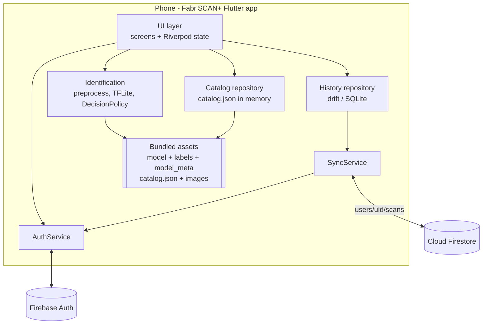
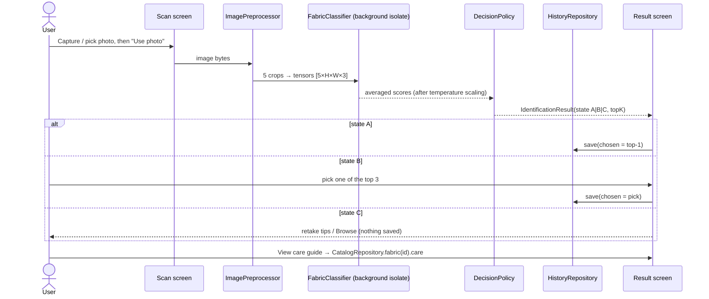
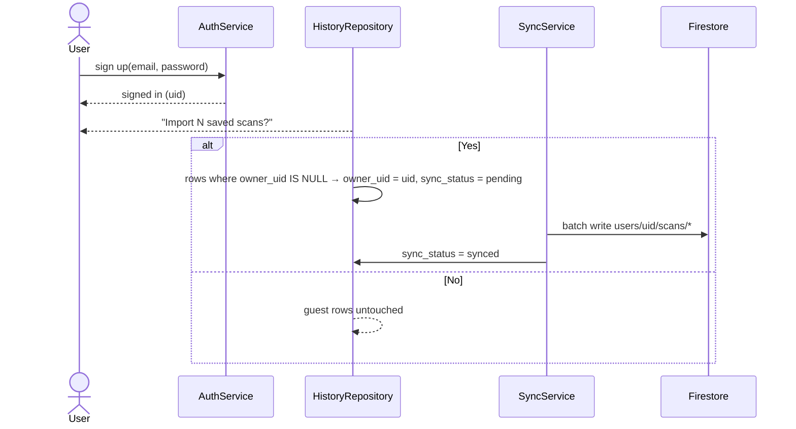

# FabriSCAN+ — Solution Architecture

**Version:** 0.1 · **Date:** 2026-11-16 · **Status:** Draft. Based on PRD v0.1 (conditionally ready). The ML parts are pending Q1–Q4.
**Decisions:** `adr/001`–`adr/008` · **ML:** `ml-plan.md` · **Dev contract:** `dev-handoff.md`

## 1. Summary
A **Flutter** app (Android + iOS) that works **offline first**:
- Fabric identification runs **on the phone** with a TFLite classifier.
- The fabric catalog and care content ship with the app as **validated JSON**.
- History is stored in **local SQLite**.
- **Firebase Auth + Firestore (free plan)** are used only when a user chooses to log in, to sync history.

There is no custom backend. Scanning, browsing, care guides and history all work in airplane mode, so the defense demo does not depend on any server.

## 2. Context


## 3. Containers


## 4. Components (app modules)
| Module (`lib/features/…`) | Responsibility | PRD |
|---|---|---|
| `onboarding` | 3-screen intro, guest/login choice, first-run flag | F7, F8 · US-01, US-02 |
| `scan` | Camera with framing overlay and tips; gallery picker; review (Use / Retake); permission handling | F1, F2 · US-10, US-11 |
| `identify` | `ImagePreprocessor` (decode, fix orientation, 5 crops, resize, normalize); `FabricClassifier` (TFLite, run off the UI thread); `DecisionPolicy` (ADR-004) → `IdentificationResult` | F3 · US-12–16 |
| `result` | Screens for states A / B / C, fiber hint, "other matches", choosing a fabric in state B | F3 · US-12–15 |
| `care` | 5-section care guide, stain types, sources, disclaimer, care symbols (Could) | F4, F11 · US-20–22 |
| `catalog` | Browse categories → fabric list → fabric detail; search (Could) | F5, F10 · US-30, US-31 |
| `history` | Auto-save, list, open, delete, clear all; thumbnails | F6 · US-40–42 |
| `account` | AuthService (email/password), sign-up/login/logout/reset/delete account, guest import prompt, SyncService | F7 · US-03–05, Q16 |
| `settings_help` | Help/how-to, photo tips, About (study info, versions, privacy note), TAM link set in the app's configuration | F8, F9 · US-50–52 |
| `core` | DB, logging, error types, `AppConfig`, theme, router | — |

## 5. Data model
### 5.1 Content (bundled `catalog.json`, read-only)
```text
Catalog { contentVersion, categories[], fabrics[], citations[] }
Category { id: "barong"|"formal"|"gowns"|"filipiniana", name, order, description }
Fabric {
  id: "FAB-PINA", name, aka[], categoryIds[],
  fiberContent[]: { fiber, type: natural|synthetic|blend, note },
  description, identifyingFeatures[], images[] (asset paths),
  care: CareGuide, careSymbols[]?, reviewedBy, reviewedOn
}
CareGuide {
  washing:  CareSection, drying: CareSection, ironing: CareSection,
  stainRemoval: CareSection & { byStain[]: { stain, steps[], citationIds[] } },
  storage:  CareSection
}
CareSection { steps[], tips[]?, citationIds[] (min 1) }
Citation { id, apa }
```

### 5.2 Local DB (drift / SQLite)
```text
scan_records(
  id TEXT PK (uuid v4), owner_uid TEXT NULL,          -- null = guest
  created_at, updated_at, deleted_at NULL,            -- deleted_at = soft-delete marker for sync
  source TEXT (camera|gallery),
  outcome TEXT (A|B),                                 -- state C is never saved (US-14)
  chosen_fabric_id TEXT, top_k_json TEXT,             -- [{fabricId, score}] x3
  thumbnail_path TEXT,                                -- 256px JPEG in app documents dir
  model_version TEXT, content_version TEXT,
  sync_status TEXT (local|pending|synced)
)
app_prefs(key PK, value)                              -- onboarding_done, etc.
```

### 5.3 Cloud (Firestore, registered users only)
```text
users/{uid}                    { createdAt }
users/{uid}/scans/{scanId}     { same fields as scan_records, minus thumbnail_path,
                                 plus thumbnailB64 (≤30 KB) }
```
Security rules: `match /users/{uid}/{doc=**} { allow read, write: if request.auth != null && request.auth.uid == uid; }`. Everything else is denied.

### 5.4 Model assets
- `assets/model/fabric_classifier.tflite`
- `labels.txt`: one fabric ID per line, plus `not_fabric`
- `model_meta.json`: `{ modelVersion, inputSize, mean, std, temperature, t_high, t_low, margin, trainedOn, testTop1, testTop3 }`

## 6. Key flows
### 6.1 Scan → identify → care (UF2)

Time budget on a mid-range phone (N2 ≤ 5 s):
- decode + orientation + crops ≤ 800 ms
- 5 inferences ≤ 1,000 ms
- save + UI ≤ 300 ms
- total target **≤ 2.5 s** (leaves headroom for budget phones)

### 6.2 Guest → sign up → import (UF5)


## 7. Non-functional requirements (technical)
| ID | Requirement | Target |
|---|---|---|
| NFR-1 | Platforms | **Android 7.0+ (API 24)**, **iOS 15+** (confirmed at M0, 2026-11-16: Flutter 3.50 and the Firebase iOS SDK both require iOS 15.0; this excludes only iPhones older than the 6s/SE from 2015) |
| NFR-2 | Reference devices | Budget Android (3 GB RAM, Android 10–12), mid-range Android, one iPhone (iOS 16+) |
| NFR-3 | Time to result (N2) | p95 ≤ 5 s on a budget device; ≤ 2.5 s on mid-range |
| NFR-4 | App size | Model ≤ 10 MB; split APK ≤ 40 MB; iOS download ≤ 60 MB |
| NFR-5 | Offline (N3) | Scan, result, care, browse, history: **100% offline**. Only login, sync and the TAM link need a network |
| NFR-6 | Cold start | ≤ 3 s to Home on a mid-range device |
| NFR-7 | Memory | Peak ≤ 300 MB during inference on the budget device (no crash out-of-memory) |
| NFR-8 | Accessibility (N7) | Text scales with system settings to 1.3× without clipping; tap targets ≥ 48 dp / 44 pt; contrast ≥ 4.5:1 |
| NFR-9 | Reliability | No crash in the 30-minute device test pass per release; Firebase Crashlytics **not** in the MVP (privacy, keeps it simple) |

## 8. Security & privacy
- **Data collected:**
  - Guests: nothing leaves the device.
  - Registered users: email address, plus scan records with a ≤ 30 KB thumbnail.
- **Never collected:** full photos, location, contacts, analytics, or ad identifiers.
- **Full photos:** processed in memory, then discarded. Only the thumbnail is stored.
- **Firestore rules:** each user can access only their own documents. Rules have unit tests run against the emulator.
- **Secrets:** the Firebase config file is public by design (the security rules are the protection). Signing keys and the Apple API key live only in CI secrets.
- **Account deletion** (Q16) and **clear history** (US-42) give users full control. Privacy note on the About screen (US-51).
- **RA 10173 (Data Privacy Act):** the privacy note explains the purpose (history sync), what is stored, and how to delete it. TAM respondents' consent is collected in the external survey form (outside the app).
- **Permissions:** camera, plus photo access through the system picker. Android 13+ uses the photo picker, which needs no storage permission.

## 9. Risks & mitigations
| # | Risk | Likelihood / Impact | Mitigation | Owner |
|---|---|---|---|---|
| **1** | **Identification accuracy too low**, especially Piña / Piña-seda / Jusi, and same-weave fabrics with different fibers | **High / High** | Week-1 feasibility spike (ADR-003); split by physical sample; ≥ 5 samples per fabric for look-alikes; 5-crop averaging; calibrated A/B/C states; fiber hint; Browse fallback; thesis reports accuracy honestly per class. **Realistic expectation:** 85–95% on *photos of samples already seen in training*, **65–85% on unseen samples**; look-alike classes lower | SA + researchers |
| 2 | Dataset late or too small | Med / High | Agree the protocol and counts now (Q4); start with the spike fabrics; the app is built with a stub classifier so development isn't blocked | PM + client |
| 3 | No Apple Developer account → no iPhone testing | Med / High | Decide the budget early (Q17); Android APK as backup; note the limitation in the thesis | PM + client |
| 4 | Care content late or without citations | Med / High | Spreadsheet template + validator; placeholder text blocks the release build | PM + researchers |
| 5 | Budget-phone performance (out-of-memory / slow) | Med / Med | float16 model ≤ 10 MB; inference in a background isolate; test on the reference budget device from M3 | Dev |
| 6 | Firebase free-tier limits | Low / Low | ~100 testers is far below the Spark limits; history sync is Should, not Must | SA |
| 7 | Fabric list changes after training | Med / Med | Freeze the list before final training; labels↔catalog validator | PM |

## 10. Traceability: PRD Must-haves → components
| Must | Component(s) |
|---|---|
| F1 / F2 Scan, Upload | `scan` |
| F3 Result | `identify`, `result`, ADR-002/004 |
| F4 Care | `care`, ADR-006 |
| F5 Browse | `catalog`, ADR-006 |
| F6 History | `history`, ADR-005 |
| F7 Guest + login | `onboarding`, `account`, ADR-005/007 |
| F8 Help & About | `settings_help` |
| N1–N7 | §7 NFR-1–8, ADR-001/008 |

## 11. Feedback to PM (added to `open-questions.md` as Q16–Q19)
1. **Q16 – Account deletion story needed.** App stores and RA 10173 require it once accounts exist. Proposed priority: Must.
2. **Q17 – Apple Developer fee (≈ ₱5,750/yr) is required for *any* iPhone test install.** Without it, R7 can't be shown with iPhone respondents.
3. **Q18 – Accuracy target needs a definition.** The PRD's 80% top-1 should be measured on **unseen physical samples**. Proposed targets: top-1 ≥ 75% and top-3 ≥ 90% on unseen samples, with seen-sample accuracy also reported. Look-alike fabrics may fall below 70% per class; the PRD should allow exceptions that are documented.
4. **Q19 – Dataset includes a `not_fabric` set** (~500 photos of everyday non-fabric things). The researchers collect it alongside the fabric photos.
