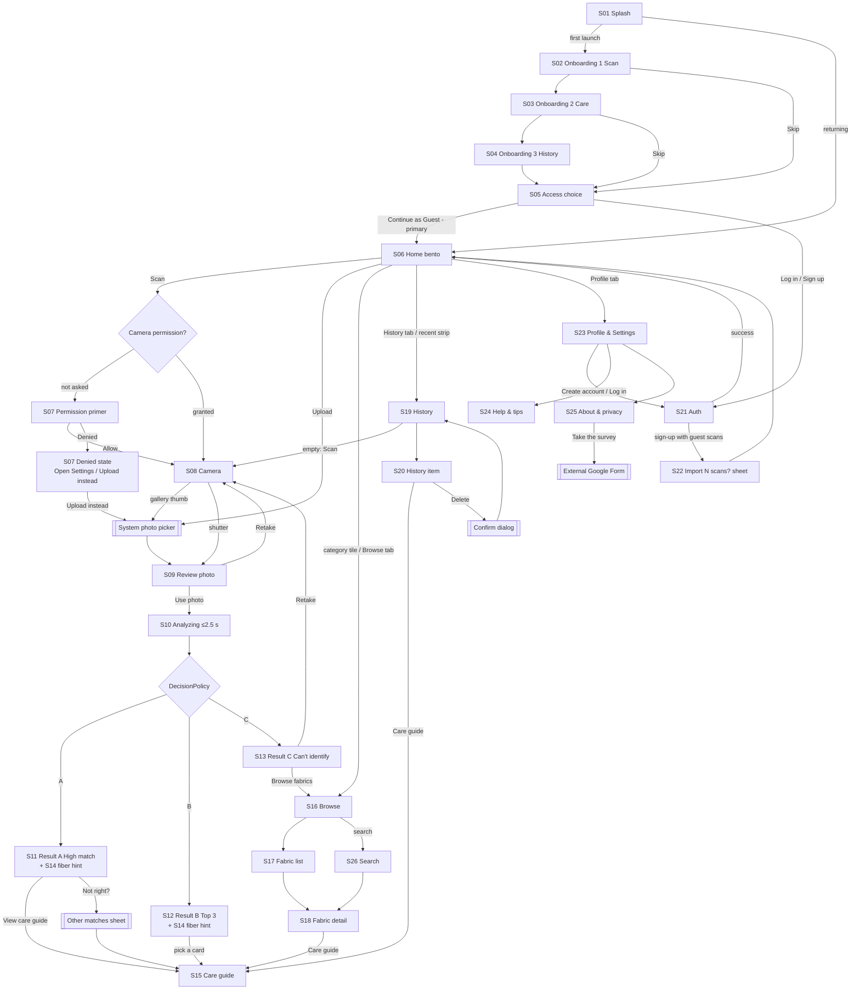

# FabriSCAN+ — User Flow Map

Version 0.1 · 2026-11-16 · Source: PRD v0.1 §5 (UF1–UF5), backlog v0.1. Screen IDs (S01–S26) are used in the prototype (`prototype/index.html#S11`) and in `handoff-notes.md`.

## Screen inventory
| ID | Screen / state | Trace |
|---|---|---|
| S01 | Splash | UF1 |
| S02–S04 | Onboarding 1–3 (Scan · Care guide · History), Skip | US-01 |
| S05 | Access choice: Continue as Guest / Log in / Sign up | US-02 |
| S06 | Home (bento) | UF1 |
| S07 | Camera permission primer + denied state | US-10 |
| S08 | Camera / scan | US-10 |
| S09 | Review photo (from camera or gallery) + "Couldn't open" error | US-10, US-11 |
| S10 | Analyzing | US-16 |
| S11 | Result A: confident (+ "Not right?" sheet) | US-12 |
| S12 | Result B: unsure, top-3 compare | US-13 |
| S13 | Result C: can't identify | US-14 |
| S14 | Fiber ambiguity hint (component inside S11/S12) | US-15 |
| S15 | Care guide (5 sections, stain types, Sources sheet, disclaimer) | US-20, US-21, US-22 |
| S16 | Browse: 4 categories | US-30 |
| S17 | Category → fabric list | US-30 |
| S18 | Fabric detail | US-30 |
| S19 | History list + empty state | US-41 |
| S20 | History item + delete confirm | US-41, US-42 |
| S21 | Log in / Sign up / Forgot password (+ error) | US-03 |
| S22 | Import guest scans (sheet) | US-04 |
| S23 | Profile / Settings | US-42, US-43 |
| S24 | Help & photo tips | US-50 |
| S25 | About & privacy + Take the survey | US-51, US-52 |
| S26 | Search (Could) | US-31 |

## Flow map

## Tap count check (UF2, after capture)
Capture → **1** Use photo → (Analyzing, automatic) → Result A → **2** View care guide → care guide visible. **2 taps.**
For state B: **1** Use photo → **2** tap the matching card → care guide. **2 taps.**

## Saving rules shown in the flow
- A: saved to History automatically when the result appears.
- B: saved when the user picks a card.
- C: nothing saved (US-14), unless the user then opens a fabric from Browse (that is browsing, not a scan).
